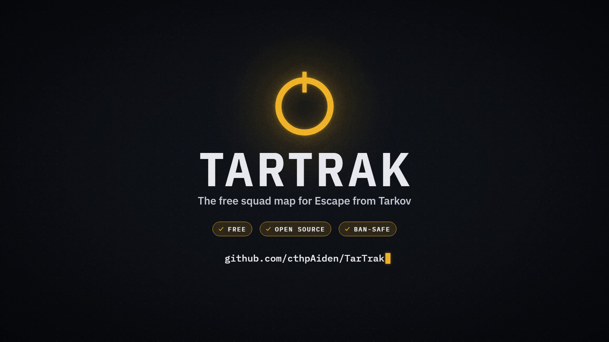

  

  A free squad map for Escape from Tarkov. Take a screenshot in raid and see where you and your teammates are.

  
  
  
  

## What it does

- Puts your position and heading on an interactive map every time you take a screenshot.
- Shows your squad on the same map, linked by a 6-character room code.
- Draws quests, extracts, bosses and loot, with filters for each.
- Runs as an overlay on top of the game in borderless windowed mode.

## Get started

1. Download the installer from the [latest release](https://github.com/cthpAiden/TarTrak/releases/latest) and run it.
2. Set Tarkov to borderless windowed.
3. In raid, press PrintScreen. Your marker shows up on the map.

TarTrak asks for administrator rights because the game runs as administrator too. Without them, Windows hides the game's key state from TarTrak and the mark-here key only works after an Alt+Tab. It needs Windows 10 or 11.

## Playing with a squad

One player clicks **Create** and shares the code. Everyone else types it in and clicks **Join**. Positions go through a small relay server that keeps nothing and logs nothing. You can [run your own](docs/developing.md#relay) if you prefer.

## Hotkeys

| Key | What it does |
| --- | --- |
| `F5` | Switch overlay mode |
| `F6` | Change overlay opacity |
| `F7` | Hide the window until you press it again |
| `Alt` + drag | Move the overlay |
| `Left Alt` + screenshot key | Drop a private marker where you stand |

Every key can be rebound in Settings.

## Is it ban-safe?

TarTrak never touches the game process. It reads three things:

- The filenames of the screenshots the game saves, which contain your coordinates and camera rotation. It can delete those screenshots afterwards, and only the ones named with coordinates.
- The game's text log, to learn which map you loaded.
- Whether your mark-here key is held down, using the same Windows call push-to-talk apps use.

It doesn't read memory, inject code, install keyboard hooks or send keystrokes to the game. There are no accounts and no telemetry. I can't speak for Battlestate's anti-cheat, but that is everything TarTrak does.

## Learn more

- [Guide](docs/guide.md): the overlay, quests, markers, routes, filters and everything else in the app.
- [Developing](docs/developing.md): build from source, the relay, releases and the data files.

## Support

TarTrak is free. If it helps your raids, you can chip in through [PayPal](https://paypal.me/HeyAiden). Tips go toward the time it takes to keep the map working after each patch.

## Credits

- Map images: [tarkov-dev-svg-maps](https://github.com/the-hideout/tarkov-dev-svg-maps), CC BY-NC-SA 4.0, fetched at runtime.
- Map transforms and quest data: [tarkov.dev](https://tarkov.dev) (MIT). Coordinate math adapted from tarkov.dev.
- Marker icons: [the-hideout/tarkov-dev](https://github.com/the-hideout/tarkov-dev) `public/maps/interactive` (MIT), copied to `public/icons/` with its licence.
- Trader portraits: Battlestate Games' artwork, loaded at runtime from tarkov.dev (assets.tarkov.dev). Not bundled and not covered by the MIT licence.
- Screenshot filename format documented by the community (TarkovMonitor).
- Fonts: IBM Plex Sans and IBM Plex Mono (SIL Open Font License 1.1), bundled through `@fontsource`.

TarTrak is MIT licensed. Escape from Tarkov is a trademark of Battlestate Games. TarTrak is not affiliated with or endorsed by them.
